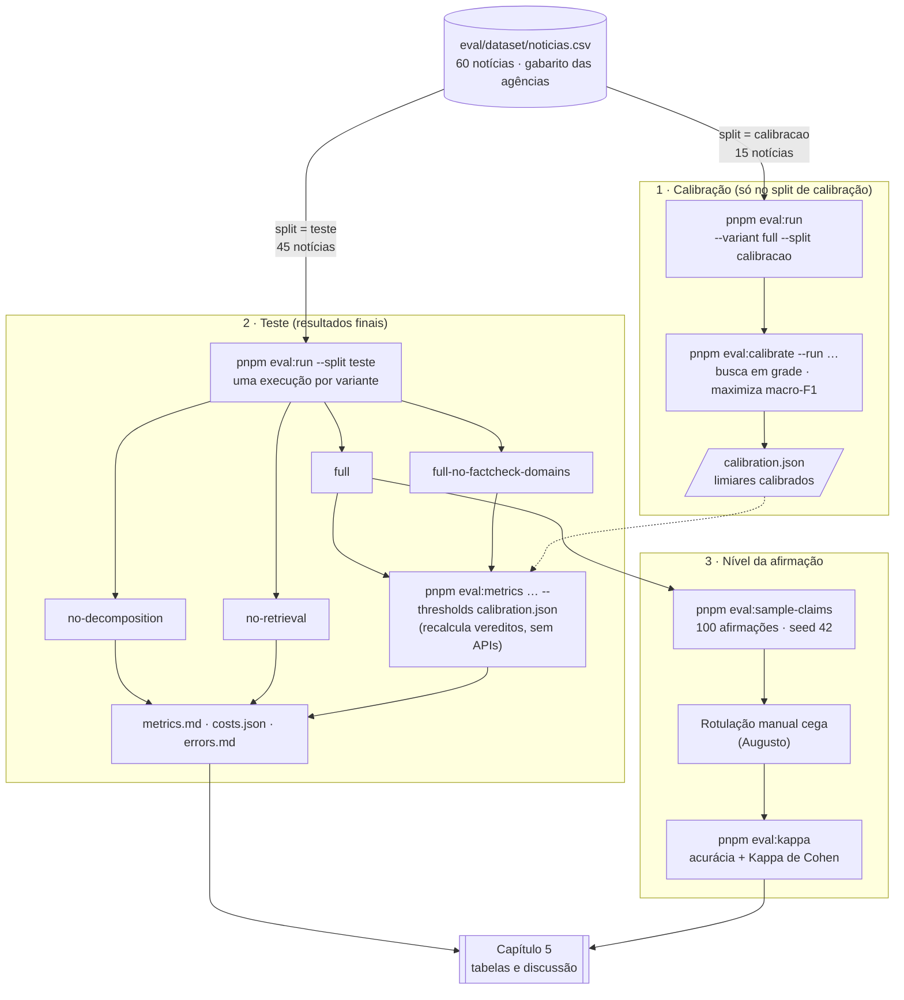

# Fluxo da avaliação (Capítulo 5)

## Leitura dos resultados

| Comparação                           | Pergunta respondida                                                           |
| ------------------------------------ | ----------------------------------------------------------------------------- |
| `full` × `no-decomposition`          | Decompor em afirmações atômicas melhora o veredito? (hipótese)                |
| `full` × `no-retrieval`              | Buscar evidências melhora em relação ao conhecimento interno do LLM?          |
| `full` × `full-no-factcheck-domains` | Quanto do acerto vem de encontrar a própria checagem (vazamento de gabarito)? |
